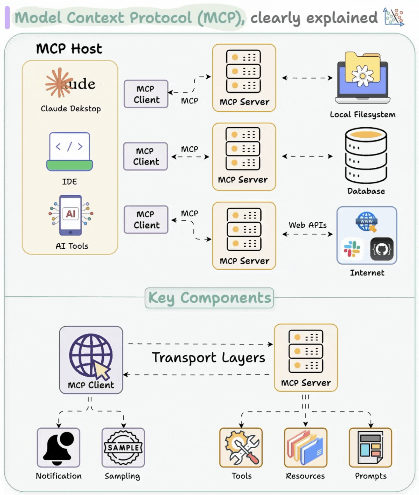
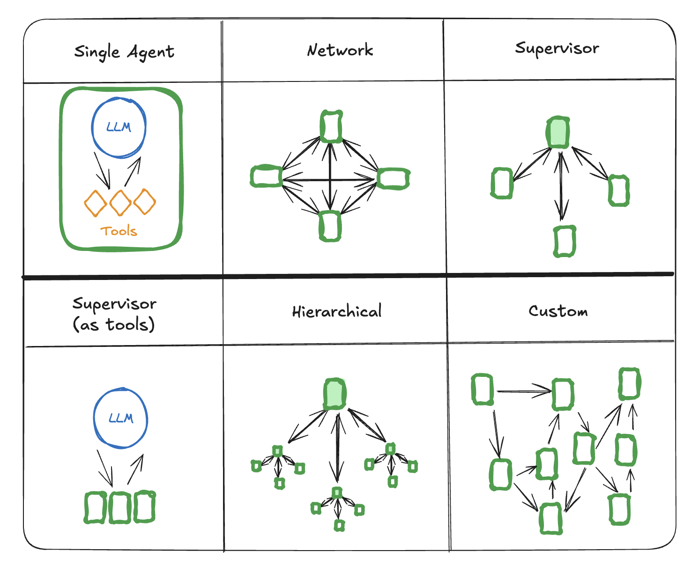

# ADEPT: Agentic Discovery and Exploration Platform for Tools

[](LICENSE.md)

[](https://pnnl.github.io/adept-agentic/)


A secure, extensible platform for building production-ready AI agent systems. Built on the Model Context Protocol (MCP) and LangGraph, ADEPT provides a three-tier architecture with centralized orchestration, plug-and-play tool discovery, and OpenAI-compatible APIs. Fully containerized (Docker/OCI + Helm) for deployment across DOE leadership computing facilities (LCFs), commercial cloud (AWS, Azure, GCP), and institutional on-premises infrastructure.

**Key Capabilities**:
- **Three-Tier Secure Architecture**: Keycloak OIDC/JWT authentication, per-tool ACL-based RBAC, zero-trust gateway mesh with SSRF prevention
- **10 Client Interfaces**: Claude Desktop/Code (MCP), ChatGPT custom GPTs (REST + OAuth2), IDE tools (Roo Code, Continue.dev, Cursor, OBot.ai) via zero-code auth proxy, AG-UI, OpenWebUI, and JupyterLab -- all through a single OpenAI-compatible API via the `adept-connectors` library
- **28+ Built-in Scientific Tools**: BLAST, UniProt, PubChem, AlphaFold, web search, sandboxed code execution, hybrid ChromaDB/pgvector RAG -- with plug-and-play MCP registration for external tools (automatic discovery, caching, and ACL-scoped provisioning)
- **Multi-Agent Orchestration**: Router mode (supervisor + workers) and Graph mode (structured plan DAGs with parallel step execution), with per-role LLM purpose routing (e.g., coding agent on Claude Opus, reasoning agent on GPT-4o)
- **Async Task Execution**: Background tool execution with task_id polling via CheckTaskStatus, PostgreSQL-backed task persistence, configurable sync/async classification per tool
- **Observability**: Langfuse tracing with multi-tier session instrumentation, LangGraph AsyncPostgresSaver checkpointing, cost tracking per LLM purpose
- **Knowledge Base Management**: Hybrid ChromaDB/pgvector backend with visibility-scoped collections (session/user/world), batch file processing, and hybrid search (keyword + vector)
- **Session Continuity**: Auto-compaction with server-side fork resolution enables indefinite conversations
- **Multi-Gateway Federation**: A2A protocol for cross-organization agent sharing with independent identity management and Globus integration for federated data transfer and compute orchestration
- **Multi-Cloud Deployment**: Containerized with Infrastructure-as-Code (AWS CDK, Azure Pulumi, GCP Terraform); Helm charts for Kubernetes; portable to DOE LCFs (ALCF, OLCF)
- **LLM-Agnostic**: Built on LiteLLM with provider-neutral routing -- Azure OpenAI, AWS Bedrock, OpenAI, Anthropic, Ollama, NVIDIA NIMs, and open-weight models on DOE LCF resources

## Citation

If you use ADEPT in your research, please cite:

> George, A., Bilbao, A., Agarwal, K., Mejia-Rodriguez, D., Samantray, S., Kim, H., Rice, P. S., Jacob, B., Baer, M., Raugei, S., Cheung, M. S., & Rigor, P. (2025). ADEPT: A Pedagogical Framework for Integrating Agentic AI with Deterministic Scientific Workflows. Zenodo. https://doi.org/10.5281/zenodo.17315801

## Architecture

ADEPT implements a production-ready three-tier architecture with clear separation of concerns:

```
Client Interfaces (10)
  Claude Desktop/Code | ChatGPT | Roo Code | Continue.dev | Cursor | OBot.ai | AG-UI | OpenWebUI | JupyterLab
                                           |
                              adept-connectors library
                                           |
                                           v
 [Tier 1: Agent Gateway]  --> [Tier 2: Orchestration Service] --> [Tier 3: MCP Tool Servers]
      Auth proxy                  Core logic + state               Stateless executors
   (Keycloak JWT)             (PostgreSQL + LangGraph)          (MCP JSON-RPC protocol)
```

**Tier 1 -- Agent Gateway**: Pure authentication proxy. Keycloak JWT validation, RBAC, CORS, transparent proxying to Tier 2. A2A mesh communication for multi-gateway federation.

**Tier 2 -- Orchestration Service**: Core brain. OpenAI Response API, ScientificWorkflowAgent, multi-agent orchestration with RolePersona and per-role LLM purpose routing, PostgreSQL-backed LangGraph checkpointing, async task execution management, dynamic tool management with ACL filtering.

**Tier 3 -- MCP Tool Servers**: Stateless executors hosting domain-specific tools via the Model Context Protocol.
- `mcp_server/` -- Scientific tools (BLAST, UniProt, PubChem, AlphaFold, document RAG, web search, file management)
- `hpc_mcp_server/` -- HPC pipelines (Nextflow, video processing, GitXray)
- `sandbox_mcp_server/` -- Secure code execution (subprocess with import blacklist [medium] or whitelist [strict] + network isolation)

**Supporting Services**: Gateway Registry (A2A federation), Keycloak (IAM), Redis (tool config + session metadata), ChromaDB/pgvector (hybrid vector store), PostgreSQL (state persistence), Langfuse (observability).



Ref: https://www.dailydoseofds.com/p/visual-guide-to-model-context-protocol-mcp/



Ref: https://langchain-ai.github.io/langgraph/concepts/multi_agent/#multi-agent-architectures

## Client Interoperability

ADEPT exposes a single OpenAI-compatible API surface to 10 client interfaces through the `adept-connectors` library:

| Client | Protocol | Integration |
|--------|----------|-------------|
| Claude Desktop / Claude Code | MCP | Native MCP server configuration |
| ChatGPT custom GPTs | REST + OAuth2 | Actions with Keycloak authorization code grant |
| Roo Code, Continue.dev, Cursor, OBot.ai | OpenAI-compatible | Zero-code auth proxy (`adept-auth-proxy`) |
| AG-UI | JSONL streaming | Direct REST |
| OpenWebUI | REST | Direct OpenAI-compatible API |
| JupyterLab | REST | Direct OpenAI-compatible API |

See [adept_connectors](examples/adept_connectors/) for drop-in configuration files and setup guides.

## Getting Started

Choose your onboarding path:

| Role | Guide | Description |
|------|-------|-------------|
| Platform Engineers | [Platform AI Engineer Onboarding](docs/PLATFORM_AI_ENGINEER_ONBOARDING.md) | Architecture deep dive, Docker Compose quick start, development workflow, testing, compliance |
| Domain Scientists | [Domain SME Vibe Coding Guide](docs/DOMAIN_SME_VIBE_CODING_GUIDE.md) | Natural language programming, RAG-powered literature understanding, case studies |
| API Consumers | [OpenAPI 3.1.0 Specification](docs/api/) | Complete reference for all 100+ endpoints with examples |

### Quick Start

```bash
# 1. Clone and configure
cp .env.example .env   # Edit with your LLM credentials

# 2. Start all services
make start

# 3. Validate
make validate
```

### Additional Resources

- [Agentic Framework Tutorial](docs/architecture/agentic-framework-tutorial.md) -- Tool development walkthrough
- [Multi-Gateway Federation Tutorial](docs/architecture/MULTI_GATEWAY_FEDERATION_TUTORIAL.md) -- Multi-organization deployment
- [A2A Gateway Mesh Workshop](examples/a2a-workshop/README.md) -- Hands-on 2-hour federation workshop
- [IP-Based Federation Quick-Start](docs/guides/A2A_IP_BASED_VM_FEDERATION_QUICKSTART.md) -- VM federation without DNS

## Example Stacks

ADEPT ships with reference MCP server implementations and tools that can be deployed alongside the core platform:

| Stack | Description |
|-------|-------------|
| [academy_mcp_server](examples/academy_mcp_server/) | Academy agent lifecycle management with Globus integration |
| [slurm_hpc](examples/slurm_hpc/) | Slurm HPC job submission and cluster management |
| [adept_connectors](examples/adept_connectors/) | Drop-in connectors for ChatGPT, Claude Desktop, and generic IDE clients |
| [adept_asopb](examples/adept_asopb/) | Agentic Security and Operations Performance Benchmark (ASOPB) framework |
| [aws_mcp](examples/aws_mcp/) | AWS infrastructure management via MCP tools |
| [opentrons_mcp_server](examples/opentrons_mcp_server/) | Opentrons liquid handler automation and protocol management |
| [mcp_server_template](examples/mcp_server_template/) | Starter template for building new MCP tool servers |
| [a2a-workshop](examples/a2a-workshop/) | Agent-to-Agent federation workshop materials |

Each stack includes its own `Makefile`, `docker-compose.yaml`, registration scripts, and test suite.

## API Compatibility

The framework exposes OpenAI-compatible endpoints, enabling drop-in use with any OpenAI SDK client:

- **Response API**: `POST /v1/responses/chat/completions` -- Chat completions with SSE streaming, function calling, and stateful checkpointing
- **Models**: `GET /v1/responses/models` -- List available models
- **Files**: `POST /v1/files` -- File upload with session-scoped storage
- **MCP Proxy**: `POST /v1/mcp` -- Direct MCP JSON-RPC access for tool discovery
- **Admin**: `/admin/tools/*` -- Runtime tool registration and ACL management

The Assistants API (`/v1/assistants/*`) is deprecated in favor of the Response API.

**LLM Provider Support**: Azure OpenAI, AWS Bedrock, OpenAI, Anthropic, Ollama, NVIDIA NIMs, open-weight models on DOE LCF resources, and any LiteLLM-compatible provider. Purpose-based model routing allows different models for different agent roles (e.g., coding agent on Bedrock Claude Opus, main agent on Azure GPT-4o).

See [docs/api/](docs/api/) for the complete OpenAPI 3.1.0 specification.

## Multi-Gateway Federation

Multiple ADEPT instances can federate while maintaining independent identity management:

- Each gateway operates with its own Keycloak server
- Trust established via service client credentials
- Gateway Registry tracks federation topology
- JWT-based authentication for Agent-to-Agent (A2A) calls
- Globus integration for secure federated data transfer and compute orchestration across DOE facilities

**Use cases**: Multi-organization collaboration, multi-region deployment, hybrid cloud, research consortia, DOE laboratory federation.

See [Federation Tutorial](docs/architecture/MULTI_GATEWAY_FEDERATION_TUTORIAL.md) and [IP-Based Quick-Start](docs/guides/A2A_IP_BASED_VM_FEDERATION_QUICKSTART.md).

## Project Structure

```
adept-agentic/
+-- src/agentic_framework_pkg/
|   +-- agent_gateway/           # Tier 1: Authentication proxy
|   +-- orchestration_service/   # Tier 2: Core orchestration + Response API
|   +-- mcp_server/              # Tier 3: Scientific tools
|   +-- hpc_mcp_server/          # Tier 3: HPC pipelines
|   +-- sandbox_mcp_server/      # Tier 3: Secure code execution
|   +-- gateway_registry/        # A2A federation service
|   +-- streamlit_app_v2/        # Web UI
|   +-- core/                    # Shared: LLM layer, secrets, credentials
+-- src/agentic_framework_sdk/   # Python SDK + CLI
+-- examples/                    # Reference MCP stacks (see table above)
+-- tests/
|   +-- unit/                    # Component-level tests
|   +-- e2e/                     # End-to-end tests
+-- docs/                        # Architecture, guides, API specs
+-- infra/
|   +-- dockerfiles/             # Service Dockerfiles
|   +-- nginx/                   # Nginx reverse proxy config
|   +-- helm/                    # Kubernetes Helm charts
|   +-- azure/                   # Azure Pulumi IaC
+-- deployment/local/docker-compose/
|   +-- docker-compose.base.yaml # Infrastructure (Keycloak, PostgreSQL, Redis)
|   +-- docker-compose.core.yaml # Application services
+-- scripts/
|   +-- release/                 # Public release pipeline + scanning tools
|   +-- deps/                    # Service health management
+-- Makefile
```

## Extending the Framework

- **Add MCP tools**: Create modules in `mcp_server/tools/`, decorate with `@mcp.tool()`, register in `main.py`
- **Register external tools**: Run any MCP server (SSE or stdio transport) and register via `agentic tools register`; ADEPT's dynamic discovery auto-detects, caches, and provisions tools via ACLs
- **Integrate LLM providers**: Configure via environment variables (LiteLLM supports 100+ providers)
- **Add example stacks**: Use `examples/mcp_server_template/` as a starting point
- **Deploy to Kubernetes**: See [Helm Deployment Guide](infra/helm/README.md)

## Validation

```bash
make validate                     # Full system validation
make validate-data                # Data-plane authentication
make validate-multi-agent         # Multi-agent orchestration
make validate-service-health      # Service credentials + MCP discovery
make validate-unit-all            # Unit tests with coverage
make validate-infrastructure-all  # Multi-cloud infrastructure tests
```

## Documentation

- **Documentation site**: [pnnl.github.io/adept-agentic](https://pnnl.github.io/adept-agentic/)
- **Docs index**: [docs/README.md](docs/README.md)
- **API reference**: [docs/api/](docs/api/)
- **Guides**: [docs/guides/](docs/guides/)
- **Architecture**: [docs/architecture/](docs/architecture/)

## Disclaimer

This material was prepared as an account of work sponsored by an agency of the United States Government. See [DISCLAIMER.md](DISCLAIMER.md) for the complete DOE/Battelle disclaimer.

## Acknowledgments and Disclosure of Funding

The research described herein was funded by the Generative AI for Science, Energy, and Security Science & Technology Investment under the Laboratory Directed Research and Development Program at Pacific Northwest National Laboratory (PNNL), a multi-program national laboratory operated by Battelle for the U.S. Department of Energy. This work was also supported by the Center for AI and the Center for Continuum Computing at PNNL. This work is also partially supported by the NW-BRaVE for Biopreparedness project funded by the U.S. Department of Energy (DOE), Office of Science, Office of Biological and Environmental Research, under FWP 81832. A portion of this research was performed on a project award (Enhancing biopreparedness through a model system to understand the molecular mechanisms that lead to pathogenesis and disease transmission) from the Environmental Molecular Sciences Laboratory, a DOE Office of Science User Facility sponsored by the Biological and Environmental Research program under Contract No. DE-AC05-76RL01830. Pacific Northwest National Laboratory is a multi-program national laboratory operated by Battelle for the DOE under Contract DE-AC05-76RL01830.

## License

BSD 2-Clause License. See [LICENSE.md](LICENSE.md) for full text.
