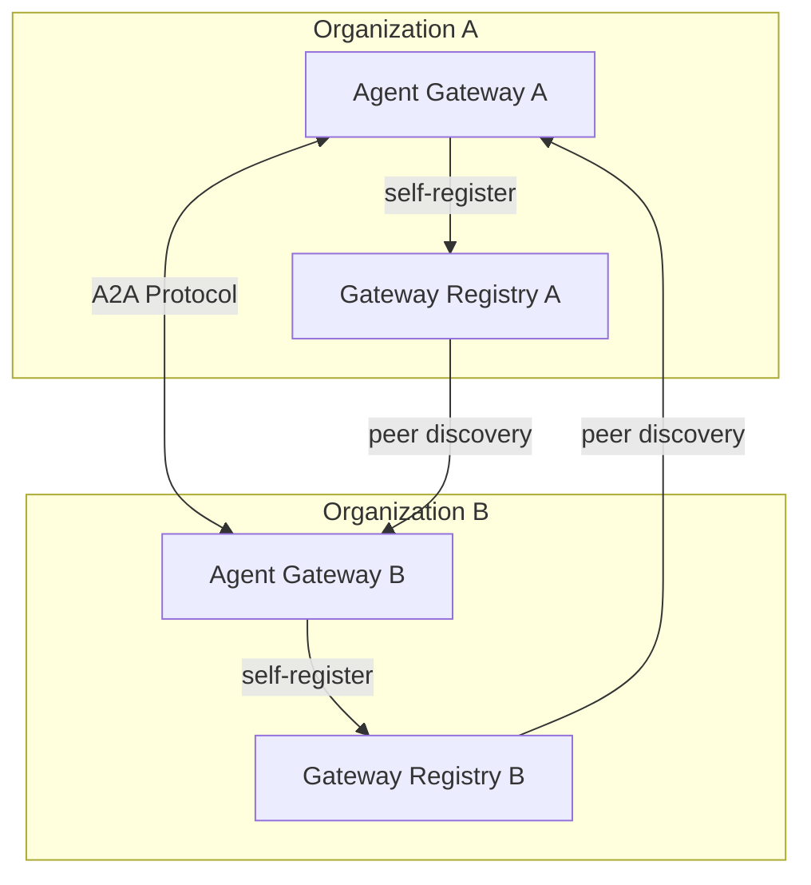
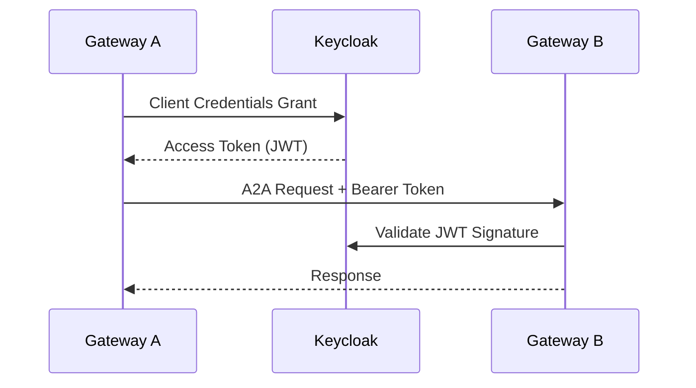

# A2A Federation

## Overview

ADEPT implements the Agent-to-Agent (A2A) protocol for cross-organization agent
sharing. Multiple ADEPT gateway instances can form a federated mesh, enabling
agents on one deployment to discover and invoke agents on another through
authenticated peer connections.

## Gateway Mesh Architecture



Each gateway maintains awareness of its peers through the Gateway Registry,
enabling transparent cross-deployment agent invocation.

## Self-Registration

On startup, each Agent Gateway automatically registers itself with its local
Gateway Registry:

1. Gateway publishes its **AgentCard** (capabilities, endpoint URL, supported tools)
2. Registry stores the registration with health metadata
3. **MeshHealthChecker** re-registers every 60 seconds to maintain liveness
4. Stale registrations are automatically pruned after configurable TTL

!!! info "Self-Healing"
    If a gateway restarts or loses its registration, the MeshHealthChecker
    automatically re-registers within 60 seconds without manual intervention.

## Mutual Trust

Cross-gateway authentication uses OAuth2 Client Credentials flow:



Key properties of the trust model:

- **JWT-based**: Standard OAuth2 tokens with cryptographic verification
- **Scoped**: Service clients have specific A2A permissions via Keycloak groups
- **Rotatable**: Client secrets can be regenerated without downtime
- **Auditable**: All cross-gateway calls carry identity claims

## CLI Commands

The `afk` CLI provides commands for managing peer gateway connections:

```bash
# Register a peer gateway
afk a2a register-peer production-gw https://gateway.example.com \
  --description "Production Gateway" \
  --tags "production,us-west-2"

# List all registered peers
afk a2a list-peers --format table

# Test connectivity to a peer
afk a2a test-connection production-gw

# Remove a peer registration
afk a2a remove-peer production-gw --yes
```

!!! note "Authentication"
    CLI commands authenticate via the `VALIDATION_RUNNER_CLIENT_ID` and
    `VALIDATION_RUNNER_CLIENT_SECRET` service credentials using Client
    Credentials flow.

## Multi-Stack Deployment

ADEPT supports running multiple isolated gateway instances on a single host
using Docker Compose multi-stack configuration:

| Component | Purpose |
|-----------|---------|
| `docker-compose.core.yaml` | Primary stack (default ports) |
| `docker-compose.multi-stack.yaml` | Additional isolated instances |

Each stack operates independently with its own:

- Agent Gateway (unique port binding)
- Orchestration Service
- MCP tool servers
- Gateway Registry entry

Stacks discover each other through the shared Gateway Registry, forming the
federated mesh automatically upon startup.

## AgentCard Publishing

Each gateway publishes an AgentCard describing its capabilities:

```json
{
  "alias": "research-gateway",
  "public_url": "https://gateway.example.com",
  "capabilities": [
    "description:Scientific research agent with HPC access",
    "tag:genomics",
    "tag:proteomics"
  ]
}
```

Peer gateways use AgentCards to route requests to the most appropriate
agent for a given task domain.
