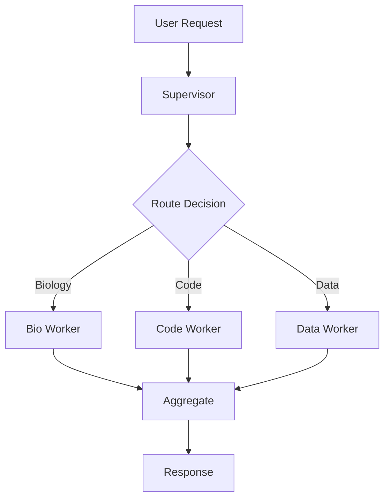

# Multi-Agent Orchestration

## Overview

ADEPT supports multi-agent teams where specialized worker agents collaborate on
complex tasks. The system provides two execution modes, purpose-specific LLM routing
per role, and full tool access inheritance for worker agents.

## Router Mode

In Router mode, a supervisor agent receives a task, generates a static execution plan,
then delegates subtasks to specialized workers sequentially:

1. Supervisor analyzes the user request
2. Plan is generated with role assignments
3. Workers execute assigned subtasks with full tool access
4. Supervisor aggregates results and responds

This mode is best for well-defined workflows where task decomposition is straightforward.

## Graph Mode

Graph mode uses LangGraph to construct dynamic task execution DAGs with state machine
logic:



Graph mode supports conditional routing, parallel execution, and iterative refinement
based on intermediate results.

## RolePersona

Worker agents are configured via the `RolePersona` data model:

```python
class RolePersona(BaseModel):
    name: str                              # Role identifier
    llm_purpose: Optional[str] = None      # LLM routing purpose
    system_prompt_template: Optional[str]  # Prompt with {role} and {base_instruction}
```

Roles can be specified as simple strings (using defaults) or as full `RolePersona`
objects for fine-grained control:

```python
# Simple string roles use default LLM
roles = ["chemist", "data_scientist"]

# RolePersona with specific LLM and prompt
roles = [
    RolePersona(
        name="security_auditor",
        llm_purpose="coding_agent",
        system_prompt_template="You are a {role} focused on vulnerability detection. {base_instruction}"
    )
]
```

## LLM Purpose Routing

Each role can target a specific LLM via the purpose routing system:

| Purpose | Typical Model | Use Case |
|---------|---------------|----------|
| `agent_main` | GPT-4o / Claude Sonnet | General reasoning (default) |
| `coding_agent` | Claude Opus | Code generation, security review |
| `biology_agent` | Domain-configured | Biological sequence analysis |
| `data_scientist` | Domain-configured | Statistical analysis |

Purpose-to-model mappings are declared in `config/model_catalog.yaml`:

```yaml
purposes:
  coding_agent:
    env_var: CODING_AGENT_DEFAULT_MODEL
    description: "Code generation and security analysis"
    aliases: ["coder", "python_developer", "security_auditor"]
```

!!! info "Additive Routing"
    Any role name not in the catalog falls back to `agent_main` automatically.
    No configuration is required to use arbitrary role names.

## Session Management

Multi-agent teams use multi-tier session identifiers for state isolation:

- `session_id` -- Base conversation thread
- `mcp_session_id` -- Tool execution context
- `multi_agent_session_id` -- Team coordination scope

State is persisted in PostgreSQL via LangGraph checkpointing, enabling session
replay and recovery.

## Tool Access

Worker agents inherit the full toolset available to the parent agent:

1. **Built-in tools**: All 28+ MCP tools via `get_builtin_mcp_tools()`
2. **External tools**: User's ACL-filtered registered tools from Redis
3. **Combined set**: Both tool types passed at worker creation

This ensures workers can perform any operation the user is authorized for,
without requiring per-worker tool configuration.

## Example Usage

Creating a mixed team with specialized LLM routing:

```python
CreateMultiAgentSession(
    task="Analyze protein structure and generate visualization code",
    roles=[
        "biologist",  # Uses agent_main (default)
        RolePersona(
            name="python_developer",
            llm_purpose="coding_agent",
            system_prompt_template="You are a {role} specializing in scientific visualization. {base_instruction}"
        )
    ]
)
```

The supervisor coordinates between workers, routing biology questions to the
biologist and code generation to the developer (which uses a more capable model
for that purpose).
