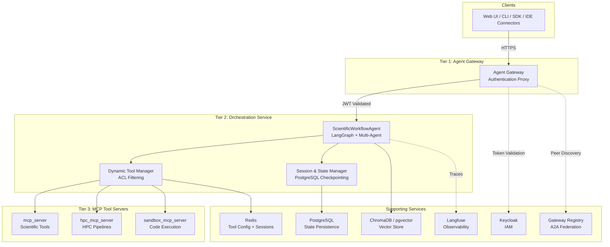
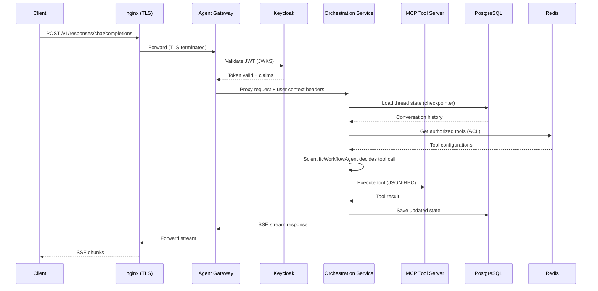

# Architecture Overview

ADEPT implements a **three-tier secure architecture** that separates authentication, orchestration logic, and tool execution into independently scalable layers. This design enables zero-trust communication between tiers, LLM-agnostic provider routing, and stateless horizontal scaling of tool servers while maintaining centralized state management in the orchestration layer.

---

## System Architecture



---

## Tier 1: Agent Gateway

The Agent Gateway serves as a **pure authentication proxy** with no business logic. All client requests pass through this layer before reaching the orchestration service.

| Responsibility | Implementation |
|---------------|----------------|
| Authentication | Keycloak JWT validation with configurable issuer |
| Authorization | RBAC via JWT `groups` claim |
| CORS | Configurable origin allowlists |
| Proxying | Transparent forwarding to Tier 2 with user context headers |
| A2A Mesh | Inter-gateway communication for federated deployments |

!!! info "Design Principle"
    The gateway performs **no request transformation** beyond authentication. This ensures that any OpenAI-compatible client can communicate with ADEPT without protocol translation at the edge.

**Key capabilities:**

- Validates JWT signatures and expiration against Keycloak JWKS endpoint
- Injects authenticated user context (`X-User-ID`, `X-User-Groups`) into forwarded requests
- Supports multiple authentication flows: ROPC (end-users), Client Credentials (services)
- Provides health and readiness endpoints for orchestrator probes

---

## Tier 2: Orchestration Service

The Orchestration Service is the **core brain** of the platform, implementing the full OpenAI Response API surface with extensions for multi-agent coordination and scientific workflows.

| Responsibility | Implementation |
|---------------|----------------|
| API Compatibility | OpenAI Response API (`/v1/responses/chat/completions`) |
| Agent Logic | ScientificWorkflowAgent with LangGraph state machine |
| Multi-Agent | RolePersona-based teams with per-role LLM purpose routing |
| State | PostgreSQL-backed AsyncPostgresSaver + LangGraph checkpointing |
| Tool Management | Runtime registration, ACL-filtered provisioning, Redis-backed config |
| Task Execution | Async streaming with SSE, background task processing |

!!! warning "State Ownership"
    **All mutable state lives exclusively in Tier 2.** MCP Tool Servers (Tier 3) are completely stateless. This is a fundamental architectural invariant.

### Multi-Agent Orchestration

The orchestration service supports two execution modes:

- **Router Mode** -- Static plan generation followed by supervised worker execution
- **Graph Mode** -- Dynamic LangGraph-based task routing with state machine transitions

Each worker agent receives a `RolePersona` configuration that determines its system prompt, available tools, and LLM model selection via purpose-based routing.

### LLM-Agnostic Provider Routing

Model selection is handled through LiteLLM with a declarative YAML model catalog:

```yaml
# config/model_catalog.yaml (simplified)
purposes:
  agent_main:
    description: General reasoning
    env_var: DEFAULT_LLM_MODEL
  coding_agent:
    description: Code generation and review
    env_var: CODING_AGENT_DEFAULT_MODEL
```

Supported providers include OpenAI, Azure OpenAI, AWS Bedrock, Ollama, and any LiteLLM-compatible endpoint. The model prefix (e.g., `bedrock/`, `ollama/`, `azure/`) determines routing.

---

## Tier 3: MCP Tool Servers

MCP Tool Servers are **stateless executors** that implement the Model Context Protocol. Each server exposes tools via `@mcp.tool()` decorators and is discovered dynamically at runtime.

### mcp_server (Scientific Tools)

General-purpose scientific tools including:

- **RAG** -- CSV/PDF ingestion, ChromaDB-backed retrieval with visibility scoping
- **Bioinformatics** -- BLAST, UniProt, AlphaFold, PubChem queries
- **Web** -- Authenticated web search and content extraction
- **File Management** -- Upload, download, presigned URL generation

### hpc_mcp_server (HPC Pipelines)

High-performance computing pipeline orchestration:

- **Nextflow** -- Pipeline submission and monitoring
- **Video Processing** -- Transcription and analysis workflows
- **GitXray** -- Repository security analysis

### sandbox_mcp_server (Code Execution)

Secure, isolated code execution environment:

- **Sandboxed Execution** -- nsjail-based isolation for untrusted code
- **Session Scoping** -- Per-session containers and filesystems
- **Language Support** -- Python, R, and shell execution

!!! note "Stateless Contract"
    MCP servers never persist state between invocations. Any session-scoped resources (temporary files, working directories) are managed through session IDs passed in the tool call context and cleaned up on session termination.

---

## Supporting Services

| Service | Role | Details |
|---------|------|---------|
| **Keycloak** | Identity & Access Management | Central IAM with JWT authentication, RBAC via groups, ROPC and Client Credentials flows |
| **PostgreSQL** | State Persistence | Conversation state, assistant configs, LangGraph checkpoints, gateway registry |
| **Redis** | Ephemeral State | Tool configuration cache, session metadata, ACL data |
| **ChromaDB / pgvector** | Vector Store | Hybrid retrieval with visibility-scoped collections (session, user, world) |
| **Gateway Registry** | A2A Federation | Service discovery for multi-gateway mesh communication |
| **Langfuse** | Observability | LLM trace collection, token usage tracking, cost attribution |

---

## Design Principles

### 1. State Isolation via Session Hierarchy

ADEPT uses a multi-tier session management model to maintain strict isolation:

| Session Type | Scope | Purpose |
|-------------|-------|---------|
| `session_id` | Conversation thread | Basic request/response context |
| `mcp_session_id` | Tool execution | Stateful MCP operations, file scoping |
| `multi_agent_session_id` | Agent team | Multi-agent coordination and shared context |
| `gateway_session_id` | Inter-gateway | A2A federated communication |

### 2. Singleton Checkpointer Pattern

A single shared checkpointer instance manages all PostgreSQL state, with isolation achieved through unique thread IDs rather than separate database connections. This reduces connection pool usage by approximately 80%.

### 3. Dynamic Tool Discovery

Tools are discovered at runtime through MCP JSON-RPC introspection (`tools/list`), eliminating dual maintenance of tool configurations. External tools registered via the gateway are combined with built-in MCP tools and filtered through per-user ACLs before provisioning to agents.

### 4. LLM-Agnostic Execution

No component depends on a specific LLM provider. The `LLMAgnosticClient` routes requests based on model name prefixes through LiteLLM, enabling seamless switching between OpenAI, Azure, AWS Bedrock, Anthropic, and local models.

### 5. Zero-Trust Inter-Tier Communication

Every request between tiers carries authenticated context. Service-to-service calls use Keycloak Client Credentials flow, and user context is propagated through headers for full audit attribution.

---

## Request Flow

The following sequence diagram illustrates a typical authenticated request from a client through all three tiers:



!!! tip "Streaming"
    The Response API endpoint supports full Server-Sent Events (SSE) streaming. Intermediate tool calls, agent reasoning steps, and final responses are all streamed as they occur, enabling real-time UI updates.
