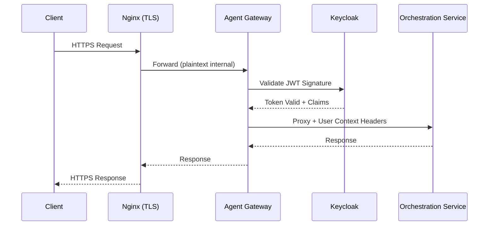

# Security Model

## Overview

ADEPT implements defense-in-depth security across three tiers: TLS termination at
the reverse proxy, JWT validation at the API gateway, and fine-grained authorization
at the orchestration layer. All inter-service communication uses authenticated
credentials, and code execution runs in hardened sandboxes.

## Authentication Flow



The Agent Gateway acts as a pure authentication proxy -- it validates identity
but delegates all business logic to the Orchestration Service.

## Authorization (RBAC)

Role-Based Access Control is enforced via Keycloak groups embedded in JWT claims:

| Group | Permissions |
|-------|-------------|
| `admin` | Full system access, user management, tool registration |
| `gateway-service` | Service-to-service communication, health checks |
| `notebook-users` | Standard agent interaction, file operations |

!!! warning "Principle of Least Privilege"
    Users receive only the permissions required for their role. Tool access
    is further restricted by per-tool ACL rules beyond group membership.

### Per-Tool ACL

Each registered tool specifies which groups may invoke it:

```python
# Tool access filtered at runtime
authorized_tools = await tool_manager.get_authorized_tools(
    user_id=user.id,
    groups=user.groups  # From JWT claims
)
```

Users only see and can invoke tools their group membership permits.

## Sandbox Security

The `sandbox_mcp_server` executes user-submitted code in isolated containers
with multiple security layers:

| Control | Implementation |
|---------|----------------|
| Container isolation | Dedicated container per execution |
| No network access | Network disabled during code execution |
| Resource limits | CPU, memory, and time constraints enforced |
| Non-root execution | Code runs as unprivileged user |
| Import restrictions | Dangerous modules blocked at import time |
| Timeout enforcement | Hard kill after configurable deadline |

## Code Execution Guardrails

Before execution, submitted code is analyzed for policy violations:

- **Blocked imports**: `os.system`, `subprocess`, `socket`, network libraries
- **Filesystem restrictions**: Write access limited to session-scoped temp directory
- **Resource caps**: Memory ceiling and CPU time limits prevent resource exhaustion
- **Output limits**: stdout/stderr truncated to prevent memory bombs

!!! info "Defense in Depth"
    Even if code bypasses import restrictions, container-level controls
    (no network, resource limits, non-root) provide secondary containment.

### Kernel-Level Syscall Filtering (nsjail)

For deployments requiring maximum isolation, ADEPT supports optional kernel-level
syscall filtering via nsjail. When enabled, all code execution occurs inside a
seccomp-BPF jail that blocks 22 dangerous system calls (container escape, kernel
modification, process inspection, filesystem escape).

nsjail is configurable per deployment:

| Deployment Type | nsjail Setting | Rationale |
|-----------------|---------------|-----------|
| Exploratory research | `false` (default) | LLM-generated code needs flexible filesystem and package management |
| Digital twins / lab automation | `true` | Code targets physical equipment; syscall restrictions prevent unintended I/O |
| Classified environments | `true` | Defense-in-depth is mandatory regardless of usability tradeoffs |
| Multi-tenant (untrusted users) | `true` | Container isolation alone is insufficient for adversarial inputs |

!!! tip "Deployment Flexibility"
    nsjail is not all-or-nothing. Operators choose the security posture appropriate
    for their trust model. The 6 existing security layers (container isolation,
    restricted env, network egress control, import validation, capability drop,
    resource limits) remain active regardless of the nsjail setting.

### Security Level Configuration

The `security_level` parameter controls the strictness of pre-execution code
analysis. Operators choose the appropriate level based on their trust model:

| Level | Import Policy | Behavior | Use Case |
|-------|--------------|----------|----------|
| `strict` | Whitelist | Only approved scientific libraries allowed (numpy, pandas, scipy, matplotlib, etc.) | Untrusted user code, public-facing deployments |
| `medium` (default) | Blacklist | Blocks known-dangerous imports (subprocess, socket, os.system, http clients) | General-purpose deployments with authenticated users |
| `permissive` | Same as medium | Identical to medium; name indicates operator intent | HPC environments needing license-server network access |

Configure via the `execute_code` tool parameter or set the default in your
deployment configuration:

```yaml
# In docker-compose environment:
SANDBOX_DEFAULT_SECURITY_LEVEL: "medium"  # strict | medium | permissive
```

When `enable_security_validation` is set to `false`, all pre-execution checks
are bypassed entirely. This is not recommended for untrusted code.

!!! warning "Security Level Does Not Replace Container Isolation"
    The security level controls **pre-execution static analysis only**. Container-level
    controls (network isolation, resource limits, non-root execution) apply regardless
    of the configured security level and cannot be bypassed from within the sandbox.

### Resource Limits

The sandbox enforces memory and CPU constraints at two levels:

**Container-level limits** (Docker Compose `deploy.resources`):

| Resource | Default | Configuration |
|----------|---------|---------------|
| Memory limit | 10 GB | `deploy.resources.limits.memory` in compose |
| Memory reservation | 2 GB | `deploy.resources.reservations.memory` in compose |
| CPU limit | 4 cores | `deploy.resources.limits.cpus` in compose |
| tmpfs session space | 1 GB | `/tmp/sandbox_sessions` (noexec, nosuid) |

**Per-execution limits** (environment variables in `.env`):

| Variable | Default | Description |
|----------|---------|-------------|
| `SANDBOX_MEMORY_LIMIT` | `20g` | Memory available to Docker-in-Docker child containers |
| `SANDBOX_MEMORY_SWAP_LIMIT` | `6g` | Swap space for DinD child containers |
| `SUBPROCESS_MEMORY_LIMIT_GB` | `30` | Memory cap for subprocess execution mode |
| `SANDBOX_DEFAULT_TIMEOUT` | `30` | Default execution timeout (seconds) |
| `SANDBOX_MAX_TIMEOUT` | `600` | Maximum allowed timeout (10 minutes) |
| `SANDBOX_DOWNLOAD_TIMEOUT` | `120` | Timeout for download operations |
| `SANDBOX_MAX_CONCURRENT_EXECUTIONS` | `5` | Max parallel subprocess executions per worker |
| `SANDBOX_MAX_CONCURRENT_DIND` | `3` | Max parallel DinD containers per worker |
| `SANDBOX_PROCESS_POOL_WORKERS` | `4` | ProcessPoolExecutor workers for parallelism |

!!! tip "Tuning for Scientific Workloads"
    For memory-intensive workloads (COBRApy, genome assembly, large dataset processing),
    increase `SUBPROCESS_MEMORY_LIMIT_GB` to match or exceed `SANDBOX_MEMORY_LIMIT`.
    The container-level memory limit should always be greater than the per-execution limit
    to accommodate the Python runtime overhead.

## Network Egress Control

By default, sandbox containers have **no external network access**. Operators can
selectively allowlist specific hosts and ports via a YAML configuration file that
is validated at container startup.

| Property | Behavior |
|----------|----------|
| No config file present | All external egress denied |
| Valid config with rules | Only listed host:port pairs reachable |
| Invalid config (parse error) | All external egress denied (fail-closed) |
| Internal services | Always reachable regardless of config |

The allowlist uses nftables rules applied during container initialization with
Pydantic schema validation ensuring only well-formed rules are accepted.
Wildcards, CIDR notation, and localhost targets are rejected.

## Response Hardening (CSP)

All responses from `nginx_proxy` include a `Content-Security-Policy` header that
prevents browser-side exfiltration of sensitive model output:

```
img-src 'self' data: blob:;
script-src 'self' 'unsafe-inline' 'unsafe-eval';
connect-src 'self' ws://$host wss://$host;
frame-ancestors 'none';
```

This blocks attacks where a model is tricked into emitting `` --
the browser will refuse to load the external image. Same-origin presigned URLs and
base64-encoded plot images remain functional.

## Service Communication

Inter-service authentication uses OAuth2 Client Credentials flow:

```bash
# Service obtains token from Keycloak
POST /realms/{realm}/protocol/openid-connect/token
  grant_type=client_credentials
  client_id=agent-gateway-client
  client_secret=<rotatable-secret>
```

Service credentials are:

- Generated during stack bootstrap
- Stored in credential directories (not environment variables)
- Retrieved via the `SecretsManager` with file-based lookup
- Rotatable without service restart via credential regeneration

## Session Isolation

User data is isolated at multiple levels:

| Level | Mechanism |
|-------|-----------|
| File storage | Per-session directories: `data/uploaded_files/{session_id}/` |
| Vector stores | Session-scoped ChromaDB collections |
| Code execution | Isolated containers with session-scoped filesystems |
| Agent state | PostgreSQL checkpoints keyed by thread ID |
| Tool context | Multi-tier session IDs propagated through all calls |

No user can access another user's uploaded files, RAG indexes, execution
results, or conversation history through any API surface.

## Credential Management

ADEPT uses file-based secret retrieval as the default pattern:

```
Lookup order:
1. /run/secrets/{SECRET_NAME}    (Docker/K8s secrets mount)
2. /app/credentials/{SECRET_NAME} (Credentials directory)
3. os.getenv("{SECRET_NAME}")     (Environment variable fallback)
```

This approach supports Docker Compose, Kubernetes, and local development
without code changes, and credentials persist across container recreations.
