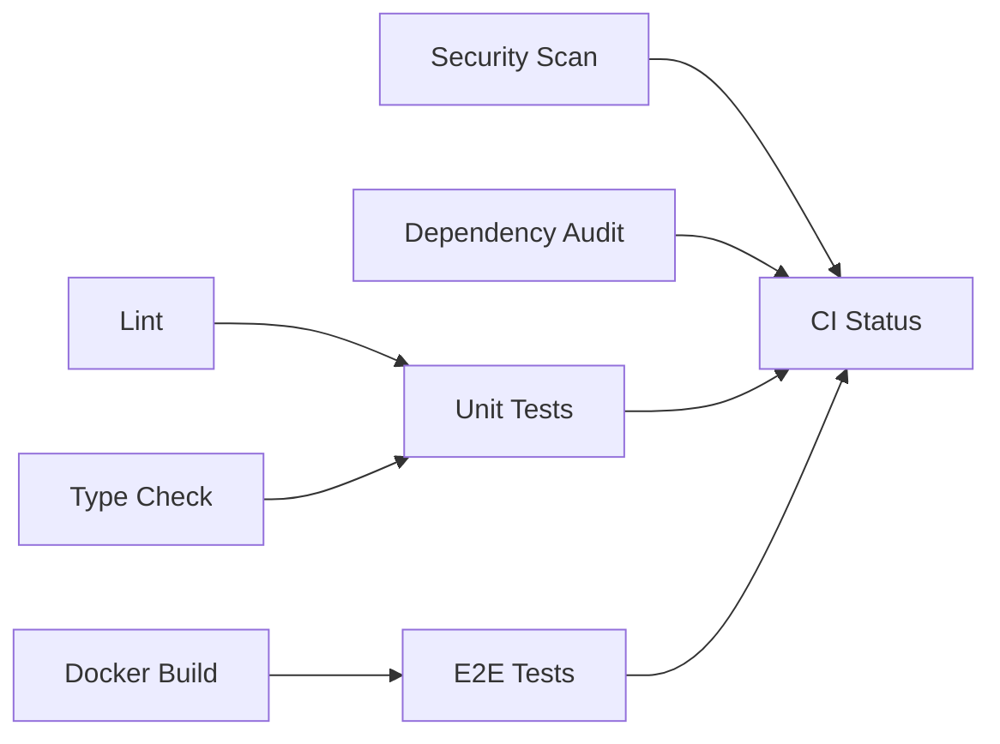

# GitHub Actions CI/CD

## Overview

ADEPT uses GitHub Actions for continuous integration, documentation deployment, and security scanning. All workflows run in containerized environments using the project's `agentic-framework-deps-base` image for reproducibility.

## Available Workflows

| Workflow | File | Trigger | Purpose |
|----------|------|---------|---------|
| Lint and Test | `lint-and-test.yml` | Push, PR to main | Code quality, unit tests, Docker builds |
| CI | `ci.yml` | Push, PR to main | Coverage reporting |
| Deploy Docs | `deploy-docs.yml` | Push to main (docs path) | Build and publish GitHub Pages |
| ASOPB Pre-Release Scan | `asopb-pre-release-scan.yml` | PR to main, manual | Security and content safety |
| Build and Push | `build-and-push.yml` | Release tag | Container image publishing |
| Deploy AWS | `deploy-aws.yml` | Manual | EKS Helm deployment |
| Deploy Azure | `deploy-azure.yml` | Manual | AKS Helm deployment |
| Deploy GCP | `deploy-gcp.yml` | Manual | GKE Helm deployment |
| Infrastructure Test | `test-infrastructure.yml` | Push (infra paths) | IaC validation |

## Documentation Deployment

The `deploy-docs.yml` workflow builds the MkDocs Material site and publishes to GitHub Pages:

```yaml
on:
  push:
    branches: [main]
    paths: ['docs/public-site/**']
  workflow_dispatch:
```

**Pipeline steps:**

1. Checkout repository
2. Install Python dependencies from `docs/public-site/requirements.txt`
3. **Content safety validation** -- scans for internal hostnames, IPs, or sensitive paths
4. Build with `mkdocs build --strict`
5. Deploy to `gh-pages` branch

!!! warning "Content Safety Gate"
    The documentation pipeline includes an automated scan that rejects any content containing internal network addresses or hostnames. This gate runs before the build step and will fail the workflow if sensitive content is detected.

## Testing Pipeline

The `lint-and-test.yml` workflow runs a comprehensive validation matrix:



### Testing Tiers

| Tier | Job | Blocking | Tools |
|------|-----|----------|-------|
| Static Analysis | `lint` | Yes | Black, isort, Ruff, Vulture |
| Type Checking | `type-check` | Yes | mypy |
| Unit Tests | `unit-tests` | Yes | pytest + coverage |
| Docker Builds | `docker-build` | Yes | Matrix across 6 services |
| E2E Tests | `e2e-tests` | Yes | pytest (critical paths) |
| Security | `security-scan` | No | Trivy (SARIF upload) |
| SCA | `dependency-check` | No | pip-audit, safety |

## ASOPB Security Scanning

The ASOPB (Agentic Security & Operations Performance Benchmark) workflow runs a multi-pass security and content safety scan on release candidates:

**Phase 1 (Blocking):** Regex-based SAST scan for secrets and sensitive patterns.

**Phase 2 (Parallel):** Full pipeline using the `adept-release-scanner` container:

- Secrets detection (TruffleHog, detect-secrets)
- SCA vulnerability scanning (Grype)
- NER/PII detection (BERT models)
- Toxicity classification
- LLM adversarial red-teaming (Promptfoo)

Results are aggregated into an ASPI (Agentic Security Posture Index) score. A minimum threshold must be met for release approval.

!!! info "Scan Duration"
    Fast passes complete in approximately 5 minutes. Full ML-enhanced scans with DLP models require approximately 60 minutes and run conditionally based on labels or manual trigger.

## Contributing to CI

When adding or modifying workflows:

1. Test locally with [act](https://github.com/nektos/act) where possible
2. Use the `agentic-framework-deps-base` image for Python-based jobs
3. Pin action versions to full SHA for supply-chain security
4. Mark advisory checks with `continue-on-error: true`
5. Add new blocking jobs to the `ci-status` needs list
