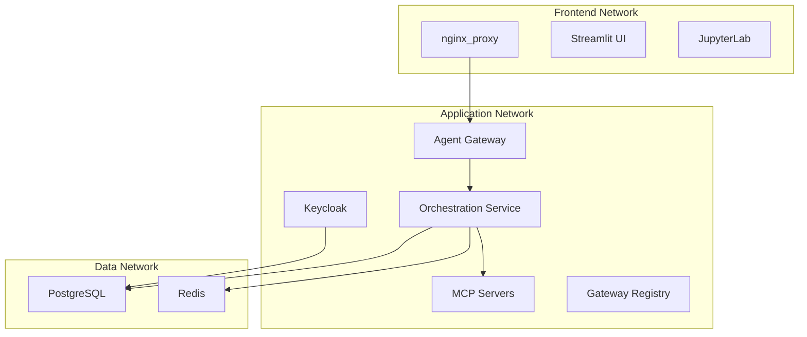

# Docker Compose Deployment

## Overview

ADEPT uses a multi-file Docker Compose architecture for local development and single-node deployments. Services are organized into layered compose files that can be combined for different deployment scenarios.

## Prerequisites

- Docker Engine 24+ with Compose V2
- 16 GB RAM minimum (32 GB recommended)
- 50 GB available disk space
- GNU Make

## Quick Start

```bash
cp .env.example .env    # Configure environment variables
make start              # Start all services
make validate           # Run validation suite
```

## Compose File Structure

ADEPT splits services across three compose files for modularity:

| File | Services | Purpose |
|------|----------|---------|
| `docker-compose.base.yaml` | PostgreSQL, Redis, Keycloak, ChromaDB | Infrastructure layer |
| `docker-compose.core.yaml` | Agent Gateway, Orchestration Service, MCP servers, Streamlit, Gateway Registry, JupyterLab | Application layer |
| `docker-compose.multi-stack.yaml` | Scaled gateway instances | Horizontal scaling |

All files reside in `deployment/local/docker-compose/` and are orchestrated via the root Makefile.

## Network Architecture

ADEPT uses a three-tier network topology for security isolation:



| Network | Role | Services |
|---------|------|----------|
| `adept_frontend_network` | User-facing ingress | nginx, OAuth2 proxy, UIs |
| `adept_application_network` | Business logic | Gateway, Orchestration, MCP, Keycloak, Registry |
| `adept_data_network` | Persistence | PostgreSQL, Redis |

## Service Management

### Lifecycle Targets

```bash
make start       # Start all services (ordered dependency resolution)
make stop        # Graceful shutdown
make restart     # Stop + start
make rebuild     # Full rebuild (no cache)
make teardown    # Remove containers, networks, and volumes
```

### Service-Specific Rebuilds

```bash
make rebuild-gateway          # Agent Gateway
make rebuild-orchestrator     # Orchestration Service
make rebuild-registry         # Gateway Registry
make rebuild-streamlit-app-v2 # Streamlit UI
```

## Volumes and Data Persistence

Persistent data is stored under the `data/` directory at the project root:

| Volume Mount | Service | Content |
|--------------|---------|---------|
| `data/postgres/` | PostgreSQL | Database files |
| `data/redis/` | Redis | Cache and session state |
| `data/chromadb/` | ChromaDB | Vector embeddings |
| `data/uploaded_files/` | Orchestration | User file uploads |
| `data/keycloak/` | Keycloak | Theme customizations |

## Environment Configuration

Copy `.env.example` to `.env` and configure required variables:

- **LLM Provider**: `DEFAULT_LLM_MODEL`, Azure/AWS/Anthropic credentials
- **Keycloak**: `KC_ADMIN_CLI_SECRET`, realm configuration
- **Database**: `POSTGRES_USER`, `POSTGRES_PASSWORD`
- **Services**: Port mappings, feature flags

!!! warning "Credential Management"
    Never commit `.env` files. Use `make fix-credentials` to regenerate service secrets after stack initialization.

## Troubleshooting

| Symptom | Cause | Fix |
|---------|-------|-----|
| Services fail to start | Missing `.env` symlink | `make create-env-symlink` |
| 401 on API calls | Stale credentials | `make fix-credentials && make sync-credentials` |
| Port conflicts | Host port collision | Check `docker ps` and adjust `.env` port mappings |
| Permission denied on data/ | Docker UID mismatch | `make init-shared-volume-permissions` |
