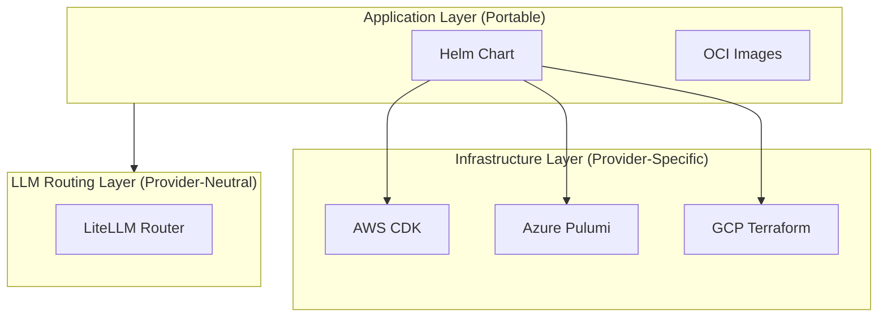
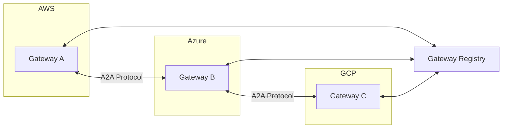

# Multi-Cloud Deployment

## Overview

ADEPT is designed for multi-cloud operation from the ground up. OCI-compliant container images, provider-neutral Helm charts, and pluggable LLM routing allow a single ADEPT deployment to span AWS, Azure, and GCP -- or federate multiple deployments across clouds using the A2A gateway mesh.

## Multi-Cloud Strategy

The architecture separates concerns into three layers:



| Layer | Portability | Tool |
|-------|-------------|------|
| Application | Fully portable | Helm + OCI images |
| Infrastructure | Provider-specific | CDK / Pulumi / Terraform |
| LLM Routing | Provider-neutral | LiteLLM abstraction |

## Provider Matrix

| Capability | AWS | Azure | GCP |
|-----------|-----|-------|-----|
| Kubernetes | EKS | AKS | GKE |
| IaC Tool | CDK (Python) | Pulumi (Python) | Terraform (HCL) |
| Managed PostgreSQL | RDS | Flexible Server | Cloud SQL |
| Managed Redis | ElastiCache | Azure Cache | Memorystore |
| Container Registry | ECR | ACR | Artifact Registry |
| Secrets | Secrets Manager | Key Vault | Secret Manager |
| LLM Provider | Bedrock | Azure OpenAI | Vertex AI |
| Ingress | ALB | App Gateway | Cloud LB |

## LLM Provider Configuration

ADEPT routes LLM requests through LiteLLM, supporting multiple providers simultaneously. The model name prefix determines the provider:

```bash
# Azure OpenAI
DEFAULT_LLM_MODEL=azure/gpt-4o

# AWS Bedrock
DEFAULT_LLM_MODEL=bedrock/us.anthropic.claude-sonnet-4-5-20250929-v1:0

# Anthropic Direct
DEFAULT_LLM_MODEL=anthropic/claude-sonnet-4-5-20250929

# Google Vertex AI
DEFAULT_LLM_MODEL=vertex_ai/gemini-2.0-flash

# Local Ollama
DEFAULT_LLM_MODEL=ollama/llama3.1

# NVIDIA NIMs
DEFAULT_LLM_MODEL=nvidia_nim/meta/llama-3.1-70b-instruct
```

!!! info "Purpose-Based Routing"
    Different agent roles can use different providers. A coding agent might use AWS Bedrock Claude while the main agent uses Azure OpenAI. Configure via `config/model_catalog.yaml`.

## Cross-Cloud Federation

The A2A (Agent-to-Agent) protocol enables ADEPT instances in different clouds to communicate:



Each gateway registers with a shared Gateway Registry. Agents on one gateway can discover and invoke tools hosted on any federated peer, enabling cross-cloud workflows without data migration.

## Deployment Patterns

### Pattern 1: Single-Cloud Full Stack

Deploy all components in one cloud provider. Simplest operational model.

```bash
# AWS example
cd infra/aws/cdk && cdk deploy --all
helm install adept infra/helm/agentic-framework/ -f values-aws.yaml
```

### Pattern 2: Multi-Cloud Federation

Deploy independent stacks per cloud, federate via A2A:

1. Deploy Stack A in AWS (owns HPC tools)
2. Deploy Stack B in Azure (owns Azure OpenAI models)
3. Register both gateways in shared registry
4. Agents in either stack can invoke tools from both

### Pattern 3: Hybrid Cloud + On-Premises

Combine cloud deployments with on-premises Docker Compose instances for air-gapped or data-sovereignty requirements. The A2A mesh treats all gateways identically regardless of hosting.

!!! warning "Network Requirements"
    Cross-cloud federation requires HTTPS connectivity between gateways on port 443. Configure firewall rules, VPC peering, or VPN tunnels as appropriate for your security posture.
