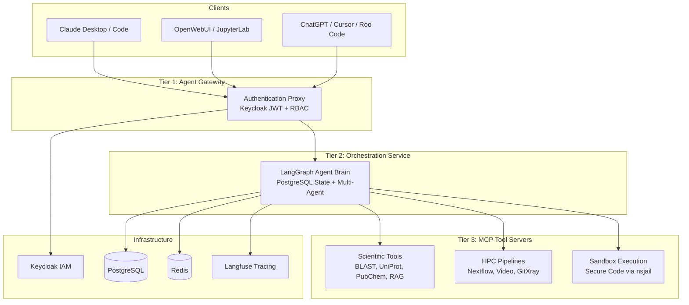

# ADEPT

**Agentic Discovery and Exploration Platform for Tools**

[](https://github.com/pnnl/adept-agentic/blob/main/LICENSE)
[](https://www.python.org/)
[](https://modelcontextprotocol.io/)

ADEPT is an open-source platform for building secure, production-ready AI agent systems with integrated scientific tooling. Built on the Model Context Protocol (MCP) and LangGraph, it provides a complete framework for deploying LLM-powered agents across multi-cloud infrastructure.

---

## Key Capabilities

- **28+ Built-in Scientific Tools** -- BLAST, UniProt, PubChem, AlphaFold, web search, sandboxed code execution, and ChromaDB-backed RAG pipelines
- **Multi-Agent Orchestration** -- Router mode (supervisor dispatches to specialized workers) and Graph mode (LangGraph DAGs with dynamic state transitions)
- **LLM-Agnostic** -- Seamless provider switching via LiteLLM: Azure OpenAI, AWS Bedrock, Anthropic, Ollama, NVIDIA NIMs, and more
- **10 Client Interfaces** -- Claude Desktop, Claude Code, ChatGPT, Roo Code, Continue.dev, Cursor, OBot.ai, AG-UI, OpenWebUI, and JupyterLab through a single API surface
- **A2A Federation** -- Agent-to-Agent protocol for cross-organization agent sharing and gateway mesh communication
- **Enterprise Security** -- Keycloak OIDC/JWT authentication with per-tool ACL-based RBAC and sandboxed code execution via nsjail
- **Multi-Cloud Deployment** -- AWS CDK, Azure Pulumi, GCP Terraform; Helm charts for Kubernetes; Docker Compose for local development
- **Observability** -- Full request tracing and token cost tracking via Langfuse integration

---

## Architecture

ADEPT implements a three-tier secure architecture separating authentication, orchestration logic, and tool execution:



| Tier | Component | Role |
|------|-----------|------|
| 1 | Agent Gateway | Pure authentication proxy -- JWT validation, CORS, transparent proxying |
| 2 | Orchestration Service | Core brain -- LangGraph agents, OpenAI-compatible API, state management |
| 3 | MCP Tool Servers | Stateless executors -- scientific tools, HPC pipelines, sandboxed code |

[:octicons-arrow-right-24: Full Architecture Overview](architecture/overview.md)

---

## Quick Start

```bash
# 1. Clone the repository
git clone https://github.com/pnnl/adept-agentic.git
cd adept-agentic

# 2. Configure environment
cp .env.example .env
# Edit .env with your LLM provider credentials (Azure OpenAI, AWS Bedrock, etc.)

# 3. Start the platform
make start
```

!!! note "Prerequisites"
    - Docker Engine 24+ with Compose v2
    - Python 3.11+ (for SDK and CLI tools)
    - At least one LLM provider configured (Azure OpenAI, AWS Bedrock, Anthropic, or Ollama)

Once running, the Agent Gateway is available at `http://localhost:8083/v1` with an OpenAI-compatible API.

!!! tip "Install the connector library"
    ```bash
    pip install adept-connectors
    ```
    The `adept-connectors` package provides client libraries for integrating ADEPT with Claude Desktop, IDE extensions, and other tools.

[:octicons-arrow-right-24: Getting Started Guides](getting-started/domain-scientists.md)

---

## Client Interfaces

ADEPT exposes an OpenAI-compatible API surface, enabling integration with a broad set of AI clients:

| Client | Integration Type | Use Case |
|--------|-----------------|----------|
| Claude Desktop | MCP Bridge via adept-connectors | Interactive research with native tool use |
| Claude Code | MCP Bridge via adept-connectors | CLI-based agent development |
| ChatGPT | OpenAI API compatibility | Familiar chat interface with ADEPT tools |
| Roo Code | MCP Bridge | VS Code agent development |
| Continue.dev | MCP Bridge | IDE-integrated coding assistance |
| Cursor | OpenAI API compatibility | AI-first code editor integration |
| OBot.ai | OpenAI API compatibility | Workflow automation |
| AG-UI | Agent Gateway UI protocol | Real-time streaming agent interface |
| OpenWebUI | OpenAI Assistants API | Self-hosted web chat interface |
| JupyterLab | OAuth2 + REST API | Notebook-based scientific workflows |

[:octicons-arrow-right-24: Connectors Guide](user-guides/connectors.md)

---

## Documentation Sections

<div class="grid cards" markdown>

- **Getting Started**

    Role-based onboarding for domain scientists, platform engineers, and system administrators.

    [:octicons-arrow-right-24: Getting Started](getting-started/domain-scientists.md)

- **Architecture**

    Three-tier design, MCP tool system, multi-agent orchestration, A2A federation, and security model.

    [:octicons-arrow-right-24: Architecture](architecture/overview.md)

- **Deployment**

    Docker Compose for local development, Kubernetes/Helm for production, multi-cloud IaC.

    [:octicons-arrow-right-24: Deployment](deployment/docker-compose.md)

- **User Guides**

    RAG workflows, CLI reference, file management, JupyterLab integration, and connector setup.

    [:octicons-arrow-right-24: User Guides](user-guides/rag-workflows.md)

- **CI/CD**

    GitHub Actions pipelines, versioning conventions, and the ASOPB security benchmark.

    [:octicons-arrow-right-24: CI/CD](ci-cd/github-actions.md)

- **Contributing**

    Contribution guidelines, code review process, and development workflow.

    [:octicons-arrow-right-24: Contributing](contributing/how-to-contribute.md)

</div>

---

## Technical Report

> Rigor, P. et al. "ADEPT: A Pedagogical Framework for Integrating Agentic AI with Deterministic Scientific Workflows." Pacific Northwest National Laboratory, 2026.

[:octicons-arrow-right-24: Read on OSTI.gov](https://www.osti.gov/biblio/3006464)

---

## License

BSD 2-Clause License. Copyright Battelle Memorial Institute 2026.

[:octicons-arrow-right-24: View License](https://github.com/pnnl/adept-agentic/blob/main/LICENSE)
