# Cross-Facility Federated Workflows: Auth, Compute, and Data Flows

**Date**: 2026-03-30
**Branch**: `fix-nginx-streaming-for-openai-endpoint-add-rc-famous`
**Related**: [A2A Workshop](../../a2a-workshop/README.md) | [Globus Tools Proposal](GLOBUS_TOOLS_PROPOSAL.md) | [Session Tracker](SESSION_TRACKER_GLOBUS_SPIFFE_SLURM.md)

---

## Facility Overview

Four facilities participate in the federated ADEPT ecosystem. Each has distinct capabilities and connectivity patterns.

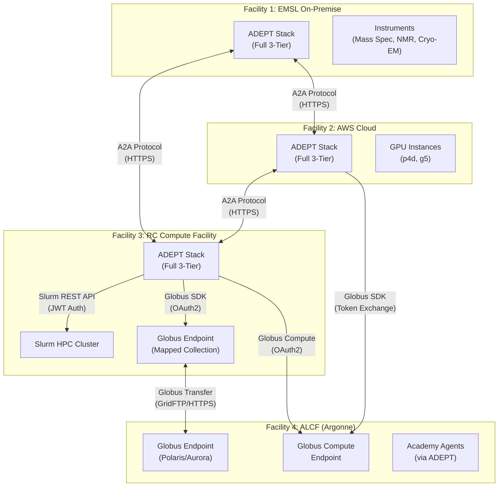

### Facility Capabilities Matrix

| Capability | EMSL (On-Prem) | AWS Cloud | RC (HPC) | ALCF (Argonne) |
|-----------|:-:|:-:|:-:|:-:|
| ADEPT Stack (3-Tier) | Y | Y | Y | Y (Academy) |
| A2A Gateway Mesh | Y | Y | Y | -- |
| Globus Transfer Endpoint | -- | -- | Y | Y |
| Globus Compute Endpoint | -- | -- | -- | Y |
| Slurm HPC Cluster | -- | -- | Y | -- |
| SPIFFE/SPIRE Workload Identity | -- | -- | Y | -- |
| Keycloak IdP | Y | Y | Y | Y |
| Globus Auth Federation | -- | -- | Y | Y |

### Identity Chain (End-to-End)

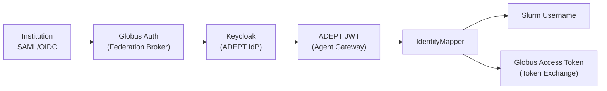

---

## Scenario 1: EMSL to AWS Cloud (Pure ADEPT A2A)

**Facilities**: EMSL (on-premise) + AWS Cloud (ADEPT-only)
**Protocol**: A2A over HTTPS
**Use Case**: A researcher at EMSL needs GPU-accelerated inference (e.g., protein structure prediction) available only on AWS GPU instances. EMSL's ADEPT delegates the task to AWS ADEPT via A2A.

### 1A. Auth Flow

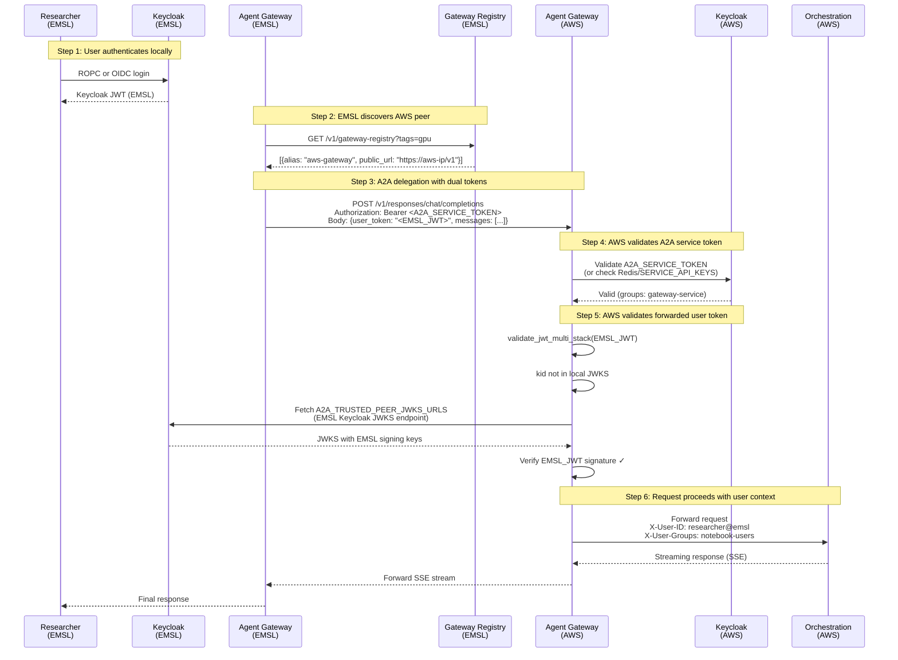

**Key Auth Mechanisms**:
- **A2A service token**: Long-lived (365-day) bearer token with `gateway-service` group, generated via `01_generate_a2a_token.sh`
- **Cross-VM JWKS federation**: `A2A_TRUSTED_PEER_JWKS_URLS` in AWS `.env` points to EMSL's Keycloak JWKS endpoint
- **Dual token pattern**: Service token authenticates gateway-to-gateway; user token preserves researcher identity

### 1B. Data Flow

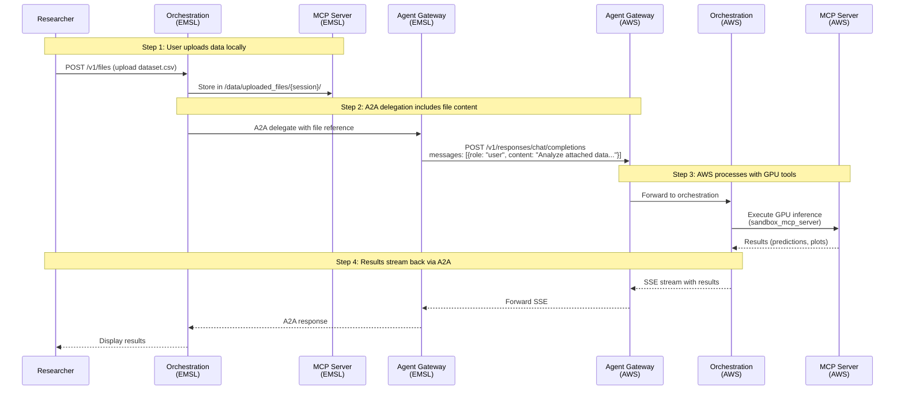

**Data Movement**: File content is embedded in A2A message bodies (no shared filesystem). For large datasets, Scenario 3 (Globus Transfer) is preferred.

### 1C. Compute Flow

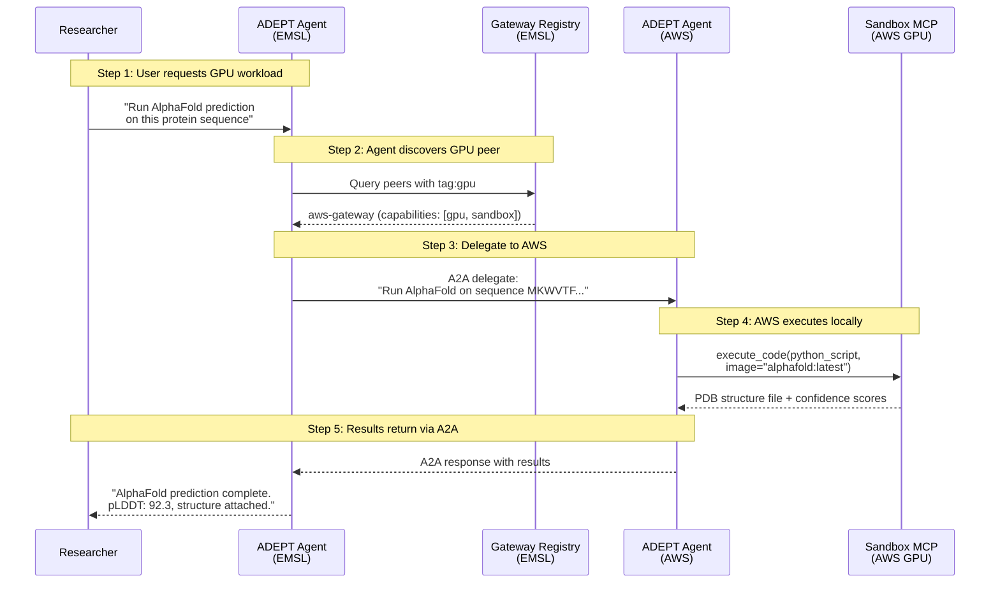

**Compute Characteristics**:
- No Globus involvement (pure ADEPT A2A)
- AWS sandbox_mcp_server provides isolated Docker execution with GPU passthrough
- Suitable for workloads under ~100MB data transfer

---

## Scenario 2: EMSL to RC (ADEPT A2A + Slurm HPC)

**Facilities**: EMSL (on-premise) + RC (ADEPT + Slurm HPC)
**Protocol**: A2A over HTTPS + Slurm REST API
**Use Case**: A researcher at EMSL submits a large-scale molecular dynamics simulation to RC's Slurm HPC cluster. The job requires hundreds of CPU cores and runs for hours.

### 2A. Auth Flow

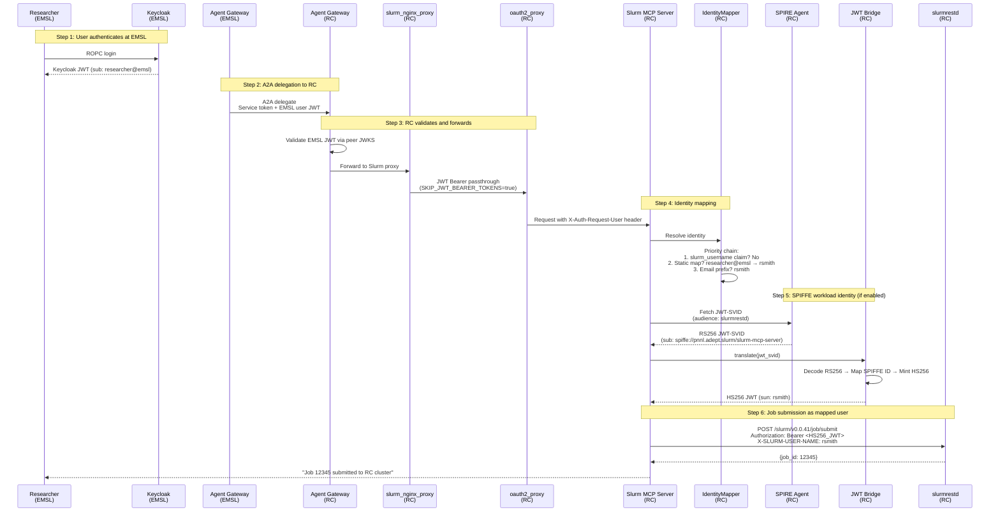

**Key Auth Mechanisms**:
- **A2A service token + JWKS federation**: Same as Scenario 1 for gateway-to-gateway
- **IdentityMapper 6-level chain**: Maps Globus/Keycloak identity to local Slurm username
- **SPIFFE JWT-SVID**: Workload identity from SPIRE agent (if `SPIFFE_ENABLED=true`)
- **JWT Bridge**: Translates RS256 SPIFFE JWT to HS256 Slurm JWT (slurmrestd limitation)
- **oauth2_proxy passthrough**: `SKIP_JWT_BEARER_TOKENS=true` allows Bearer tokens through nginx

### 2B. Data Flow

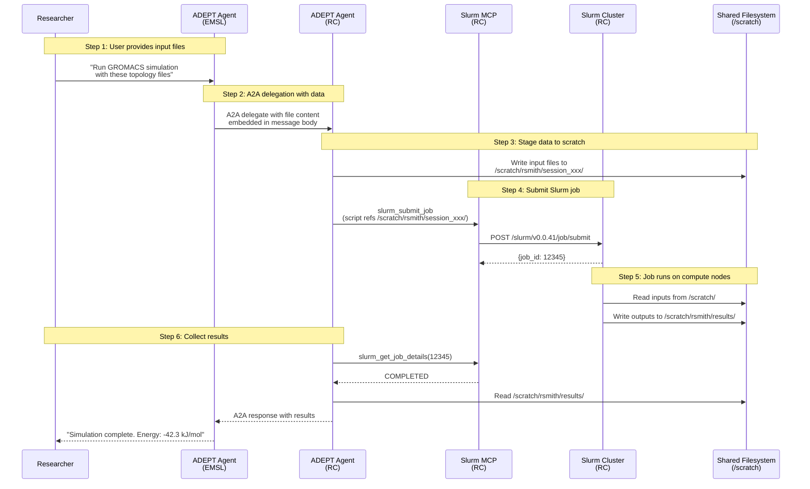

**Data Movement**: For datasets small enough to embed in A2A messages (~100MB), data flows through message bodies. For larger datasets, see Scenario 3 which uses Globus Transfer.

### 2C. Compute Flow

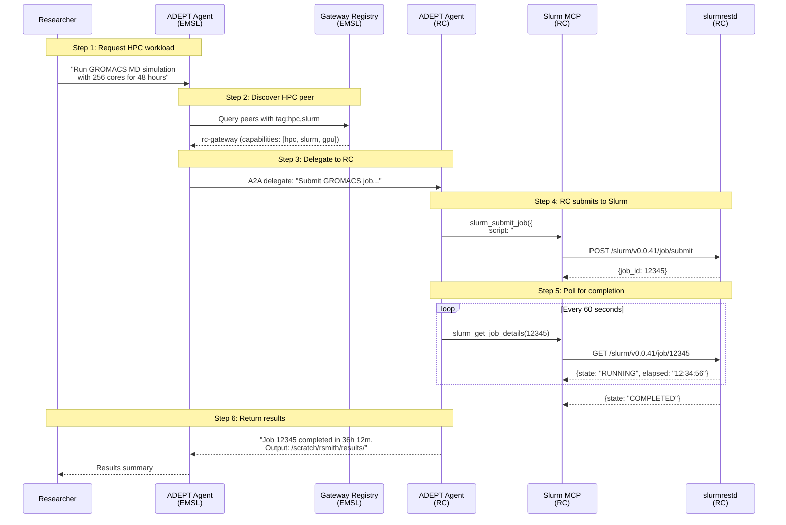

---

## Scenario 3: AWS Cloud to RC with Globus Data Staging

**Facilities**: AWS Cloud (ADEPT) + RC (ADEPT + Globus + Slurm)
**Protocol**: A2A + Globus Transfer + Slurm REST
**Use Case**: A cloud-based analysis pipeline needs to stage 500GB of genomics data from a Globus collection to RC's scratch filesystem, run a Nextflow pipeline on Slurm, then transfer results back to a cloud storage endpoint.

### 3A. Auth Flow

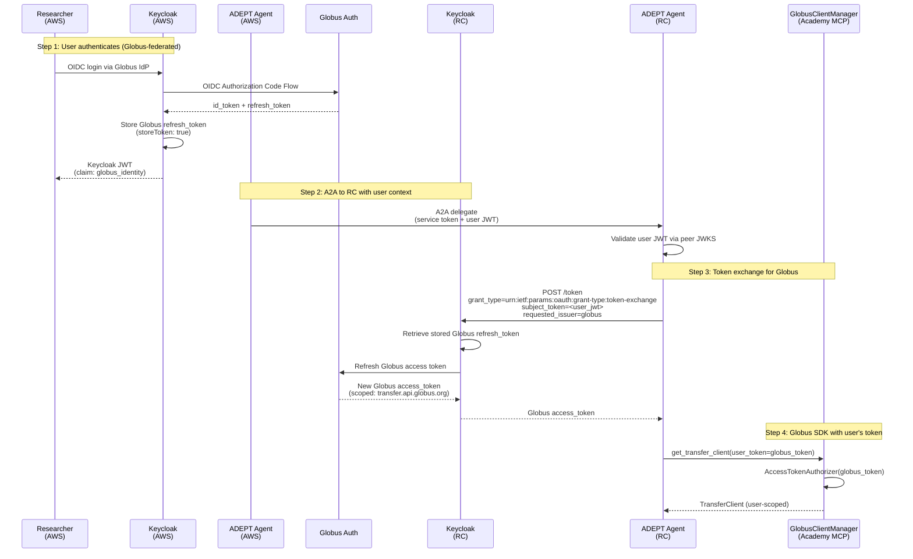

**Key Auth Mechanisms**:
- **Globus-federated Keycloak login**: User authenticates via institution SAML → Globus Auth → Keycloak OIDC IdP
- **RFC 8693 token exchange**: Keycloak exchanges user JWT for Globus access token using stored refresh token
- **User-scoped Globus operations**: All Globus API calls use the researcher's identity (data access governed by Globus ACLs)

### 3B. Data Flow

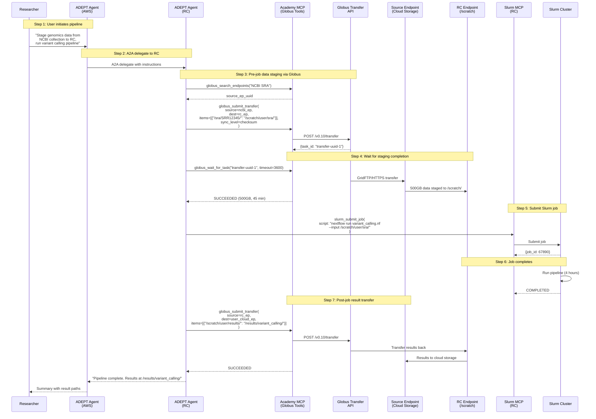

**Data Staging Pattern**:
1. **Pre-job**: `globus_submit_transfer` → `globus_wait_for_task` → data on `/scratch`
2. **Job execution**: Slurm reads from `/scratch`, writes results to `/scratch`
3. **Post-job**: `globus_submit_transfer` → results back to user's endpoint

### 3C. Compute Flow

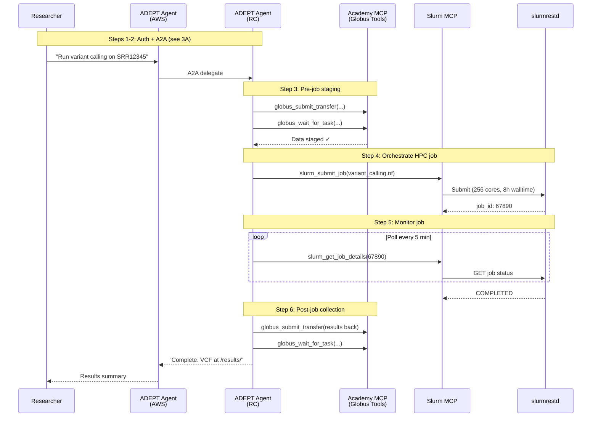

---

## Scenario 4: RC to ALCF (Globus Compute at DOE Facility)

**Facilities**: RC (ADEPT + Globus) + ALCF (Globus Compute endpoint on Polaris/Aurora)
**Protocol**: Globus SDK (Compute + Transfer)
**Use Case**: RC's ADEPT orchestrates a large-scale AI training job on ALCF's Polaris supercomputer using Globus Compute, with data staged via Globus Transfer.

### 4A. Auth Flow

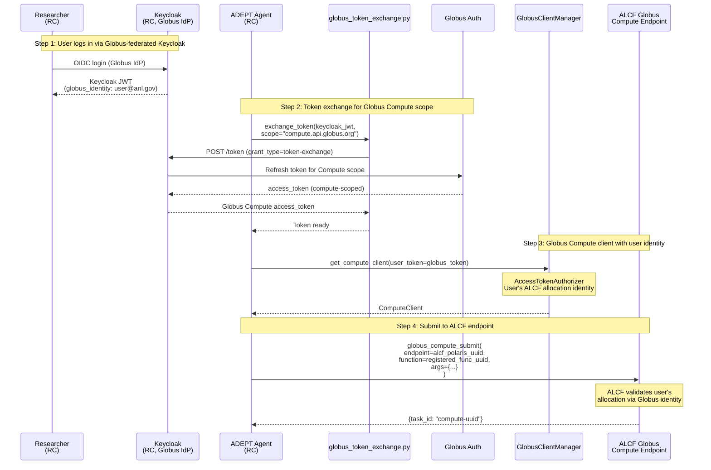

**Key Auth Mechanisms**:
- **Globus identity federation**: User's institutional identity → Globus Auth → Keycloak → ADEPT JWT
- **Token exchange for Compute scope**: RFC 8693 exchange gets Compute-scoped Globus token
- **ALCF allocation check**: Globus Compute endpoint validates user has active ALCF allocation via their Globus identity
- **No SPIFFE needed**: Globus Compute handles workload identity at the facility level

### 4B. Data Flow

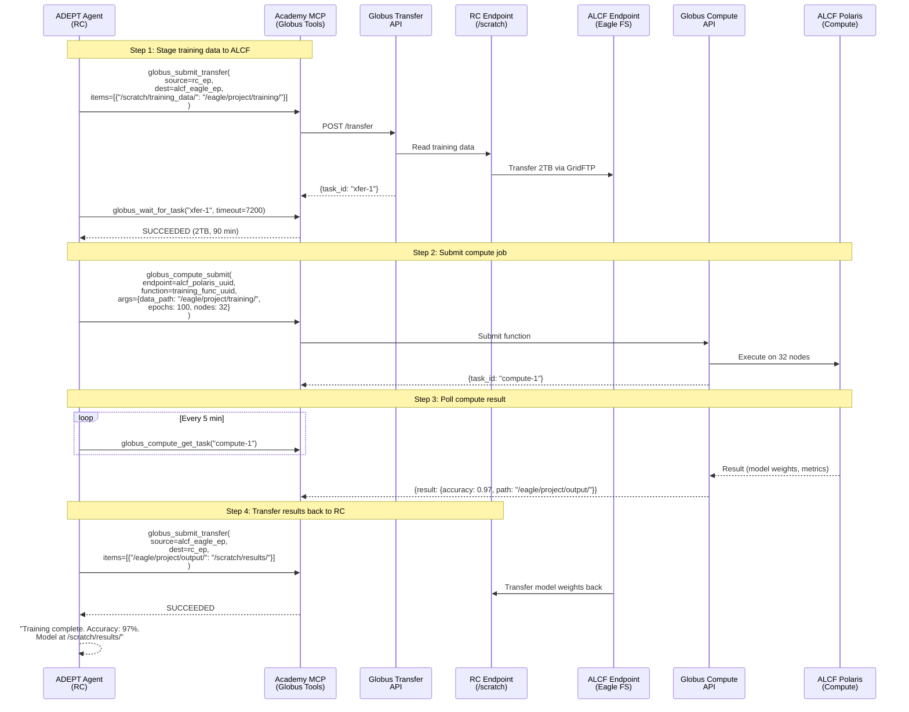

### 4C. Compute Flow

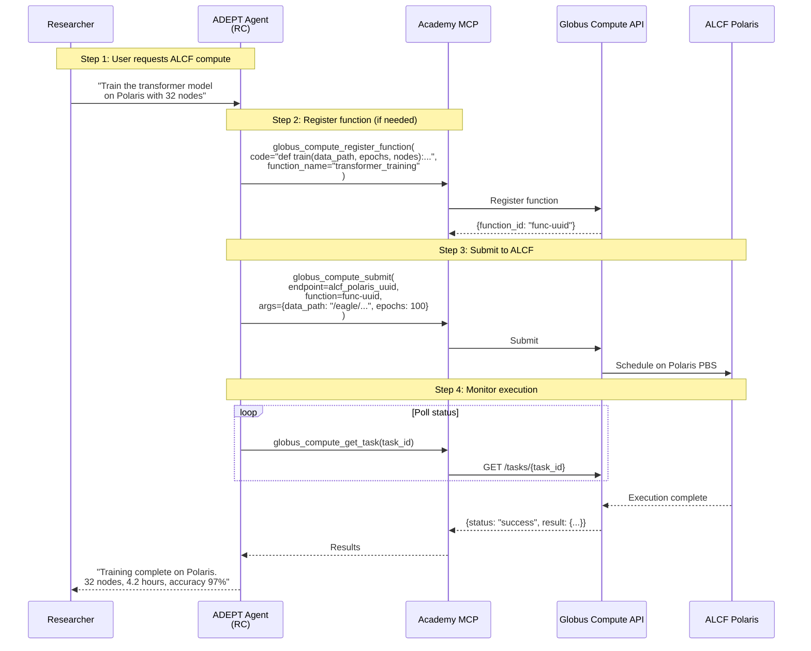

---

## Scenario 5: EMSL to ALCF via RC (Multi-Hop Federated Workflow)

**Facilities**: EMSL (origin) → RC (intermediary, Globus-enabled) → ALCF (compute target)
**Protocol**: A2A (EMSL→RC) + Globus SDK (RC→ALCF)
**Use Case**: An EMSL researcher needs to run a compute-intensive cryo-EM reconstruction on ALCF's Aurora GPU cluster. EMSL has no Globus endpoint, so RC acts as the Globus-enabled intermediary.

### 5A. Auth Flow (Multi-Hop)

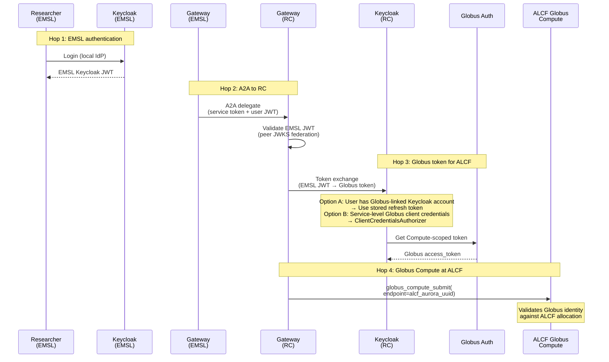

**Auth Complexity**: Three distinct auth domains are bridged:
1. **EMSL Keycloak** → A2A service token → **RC Keycloak** (JWKS federation)
2. **RC Keycloak** → RFC 8693 token exchange → **Globus Auth** (stored refresh token)
3. **Globus Auth** → Compute scope → **ALCF** (allocation-based access)

### 5B. End-to-End Data + Compute Flow

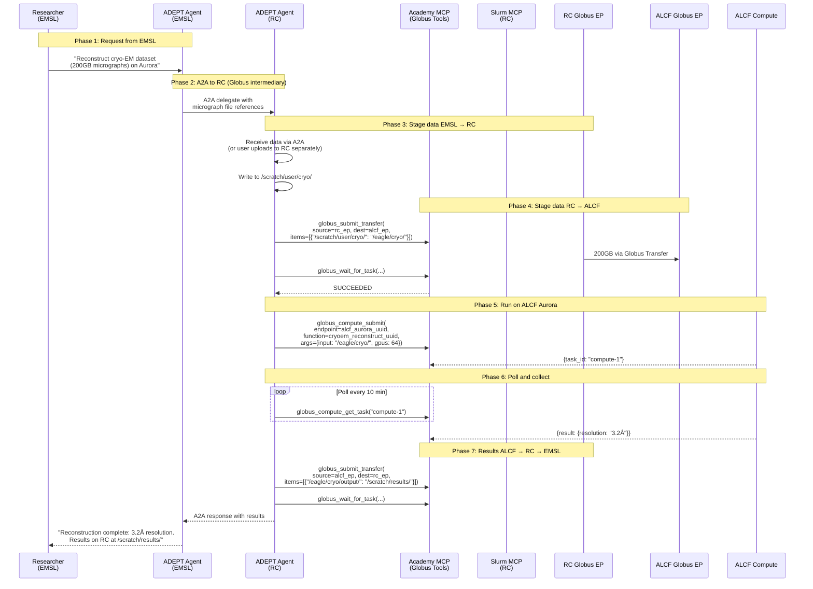

---

## Scenario 6: Full Federated Meta-Orchestration (All 4 Facilities)

**Facilities**: All four — EMSL + AWS + RC + ALCF
**Protocol**: A2A + Globus Transfer + Globus Compute + Slurm
**Use Case**: A multi-facility drug discovery pipeline: (1) EMSL generates proteomics data, (2) AWS runs ML inference for target identification, (3) RC runs molecular dynamics on Slurm, (4) ALCF runs large-scale docking simulations on Polaris.

### 6A. Meta-Orchestration Architecture

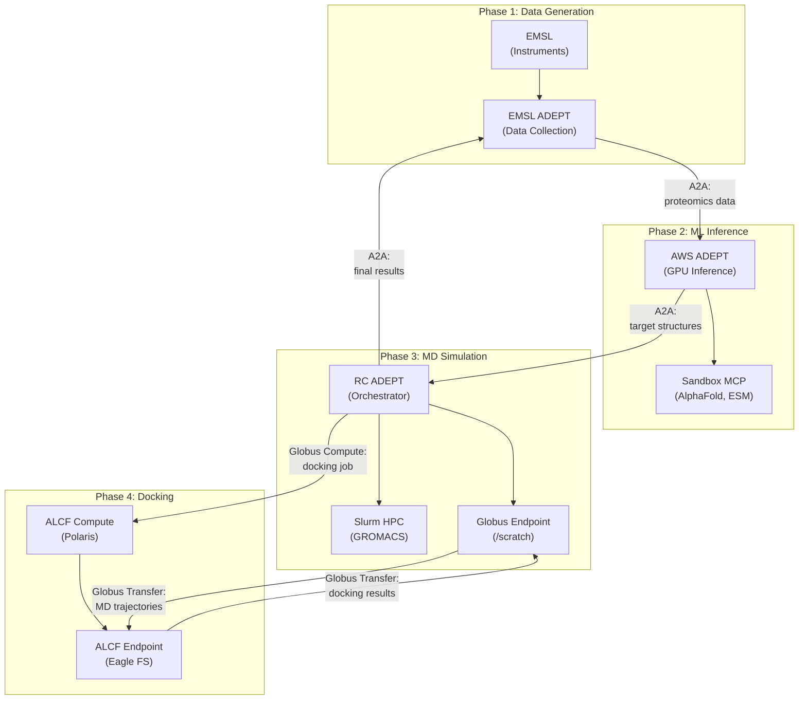

### 6B. End-to-End Sequence

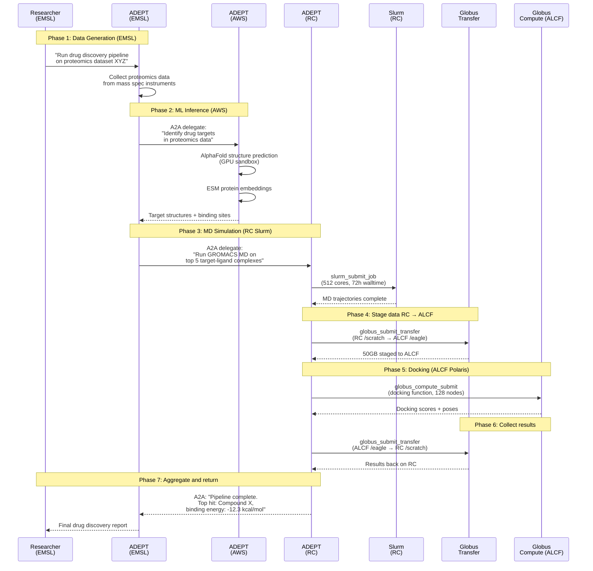

### 6C. Auth Flow Summary (All Hops)

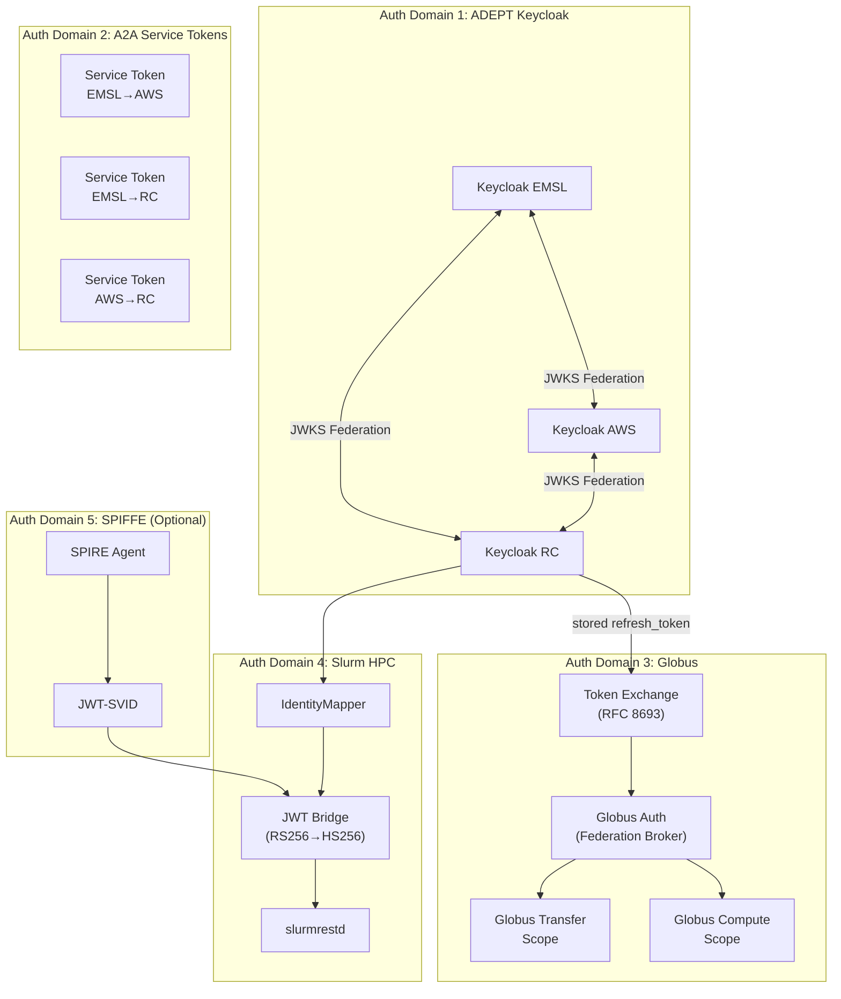

| Hop | Source | Destination | Auth Mechanism | Token Type |
|-----|--------|-------------|----------------|------------|
| 1 | User | EMSL Keycloak | ROPC or OIDC | Keycloak JWT |
| 2 | EMSL GW | AWS GW | A2A service token + peer JWKS | Bearer + JWT |
| 3 | AWS GW | RC GW | A2A service token + peer JWKS | Bearer + JWT |
| 4 | RC Agent | Globus Auth | RFC 8693 token exchange | Globus access_token |
| 5 | RC Agent | Globus Transfer | AccessTokenAuthorizer | Globus OAuth2 |
| 6 | RC Agent | Globus Compute (ALCF) | AccessTokenAuthorizer | Globus OAuth2 |
| 7 | RC Agent | slurmrestd | IdentityMapper + JWT Bridge | HS256 JWT |
| 8 | SPIRE Agent | JWT Bridge (optional) | Workload API | RS256 JWT-SVID |

---

## Scenario Summary Matrix

| Scenario | Facilities | Auth | Data Transport | Compute | Complexity |
|----------|-----------|------|----------------|---------|------------|
| 1. Pure A2A | EMSL ↔ AWS | Keycloak JWT + A2A tokens + JWKS federation | A2A message body | AWS sandbox (GPU) | Low |
| 2. A2A + Slurm | EMSL → RC | + IdentityMapper + SPIFFE + JWT Bridge | A2A message body + /scratch | Slurm HPC | Medium |
| 3. Globus Staging | AWS → RC | + Globus token exchange (RFC 8693) | Globus Transfer (GridFTP) | Slurm HPC | Medium-High |
| 4. Globus Compute | RC → ALCF | + Globus Compute scope + ALCF allocation | Globus Transfer | Globus Compute (Polaris) | Medium |
| 5. Multi-Hop | EMSL → RC → ALCF | A2A + token exchange + Globus | A2A + Globus Transfer | Globus Compute | High |
| 6. Full Pipeline | All 4 | All mechanisms combined | A2A + Globus Transfer | Sandbox + Slurm + Globus Compute | Very High |

---

## Implementation Status

| Component | Status | Reference |
|-----------|--------|-----------|
| A2A Gateway Mesh (Scenarios 1-2) | **Production** | [A2A Workshop](../../a2a-workshop/README.md) |
| Globus 28 MCP Tools (Scenarios 3-6) | **Implemented** | [Globus Tools Proposal](GLOBUS_TOOLS_PROPOSAL.md) |
| Globus Token Exchange (Scenarios 3-6) | **Implemented** | `src/.../core/globus_token_exchange.py` |
| Slurm MCP Server (Scenarios 2-3) | **Implemented** | `examples/slurm_hpc/` |
| SPIFFE/SPIRE Phase 0-2 (Scenario 2) | **Implemented** | `examples/slurm_hpc/docs/SPIFFE_IMPLEMENTATION_TRACKER.md` |
| IdentityMapper (Scenario 2) | **Implemented** | `examples/slurm_hpc/slurm_mcp_server/slurm_mcp/identity_mapper.py` |
| JWT Bridge RS256→HS256 (Scenario 2) | **Implemented** | `examples/slurm_hpc/slurm_mcp_server/slurm_mcp/jwt_bridge.py` |
| Globus Compute at ALCF (Scenario 4) | **Tools Ready** | Needs ALCF endpoint UUID + allocation |
| Full Meta-Orchestration (Scenario 6) | **Design** | Requires all components integrated |
| SPIFFE Phase 3-4 (Production) | **Not Started** | Needs live SPIRE infra + OPA policies |
